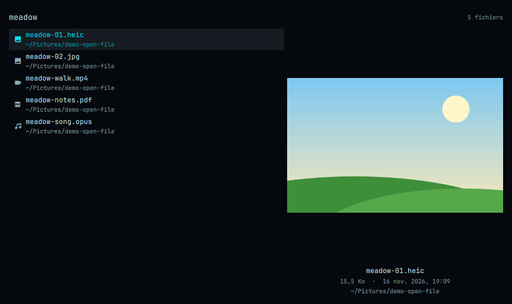

# Ouvrir un fichier — un lanceur qui part du document, pour Omarchy

Un panneau de recherche pour [Omarchy](https://omarchy.org) qui part du document plutôt
que de l'application : tapez quelques lettres du nom d'un fichier, regardez l'aperçu,
appuyez sur Entrée, et le fichier s'ouvre dans son application par défaut. Ctrl+Entrée
ouvre à la place son dossier dans Files.



## Ce qu'il fait

- Cherche parmi **tous les fichiers du dossier personnel**, par leur nom, à chaque frappe.
  La liste est lue à l'ouverture du panneau et filtrée en mémoire : aucune limite de
  nombre, aucun index à entretenir.
- Classement : les noms qui **commencent par** le texte tapé, puis ceux qui le
  contiennent, puis les fichiers trouvés par le nom de leur dossier ; du plus récent au
  plus ancien dans chaque groupe.
- Ni la casse ni les accents ne comptent (`evenement` trouve `Événement.odt`). Plusieurs
  mots resserrent la recherche et peuvent viser le dossier (`img downloads`).
- Sans recherche, il liste les fichiers modifiés le plus récemment.
- Volet d'aperçu :
  - images, **HEIC, AVIF et JPEG XL compris**, en miniature ;
  - première page des PDF ;
  - vidéos lues sans le son, en boucle ;
  - fichiers audio joués (pré-écoute), avec position et durée ;
  - tout fichier : nom, taille, date et dossier.
- Une vidéo ou un morceau ne démarre que sur Tab, et s'arrête dès qu'on appuie de nouveau
  sur Tab, qu'on passe à autre chose ou qu'on ferme le panneau.
- Suit le thème d'Omarchy (couleurs du menu) et sa langue (anglais et français fournis).

## Touches

| Touche | Action |
|--------|--------|
| lettres | filtrer |
| Haut / Bas, Page préc. / Page suiv. | parcourir la liste |
| Entrée, ou un clic | ouvrir le fichier |
| Ctrl+Entrée ou Maj+Entrée | ouvrir plutôt le dossier du fichier dans Files |
| Tab | lire ou arrêter la vidéo ou le morceau sélectionné |
| Retour arrière, Ctrl+Retour arrière, Ctrl+U | corriger la recherche |
| Échap | effacer la recherche, puis fermer |

## Prérequis

- Omarchy avec le shell fondé sur Quickshell (Quattro).
- Pour les aperçus, tout est facultatif — un outil absent, c'est seulement une miniature
  en moins :
  - `libvips` (`vipsthumbnail`) ou `imagemagick` pour les images, et `libheif` pour
    HEIC/AVIF (le JPEG XL demande `imagemagick`) ;
  - `librsvg` (`rsvg-convert`) pour les SVG ;
  - `poppler` (`pdftoppm`) pour les PDF ;
  - `ffmpegthumbnailer` pour les miniatures de vidéos ;
  - `bubblewrap` (`bwrap`) pour enfermer les outils de miniature ;
  - `qt6-multimedia` et `qt6-multimedia-ffmpeg` pour lire vidéos et sons dans le panneau.

## Installation

```sh
omarchy plugin add https://github.com/swald54000/omarchy-open-file.git --enable
```

Le greffon est un panneau plein écran, pas un widget de barre : donnez-lui une touche.
Dans `~/.config/hypr/bindings.lua` :

```lua
o.bind("SUPER + ALT + SPACE", "Open file", "omarchy-shell shell toggle swald.files '{}'")
```

Utilisez `o.rebind` à la place de `o.bind` si la touche est déjà prise.

## Réglages

Les dossiers cachés et ceux nommés `node_modules`, `target`, `__pycache__`, `build`,
`dist` et `venv` sont ignorés. Pour en ignorer d'autres, listez des chemins relatifs au
dossier personnel, un par ligne, dans `~/.config/swald.files/exclude` :

```
# gros dossiers sans rien à ouvrir
Games
Sources/linux
```

Les miniatures sont gardées dans `~/.cache/swald.files`, lisibles par vous seul, et
supprimées après 30 jours.

Les aperçus sont faits sur des fichiers de toute origine dès qu'une ligne est sélectionnée :
les outils d'image sont donc bridés. ImageMagick suit `magick/policy.xml` (formats d'image
attendus seulement, aucun programme externe comme Ghostscript) et libvips tourne sans ses
décodeurs peu sûrs. Si `bwrap` est installé, chaque outil de miniature tourne en plus dans
un bac à sable : pas de réseau, et du dossier personnel seulement le fichier aperçu (en
lecture) et le cache des miniatures. Sans lui, les outils tournent sans bac à sable. La
vidéo et l'audio sont lus par le shell lui-même, hors de tout bac à sable : c'est pourquoi
rien n'est lu avant un appui sur Tab.

## Désinstallation

```sh
omarchy plugin remove swald.files
```

Supprimez ensuite le raccourci, puis `~/.config/swald.files` et `~/.cache/swald.files`
s'ils existent.

## Fonctionnement

`OpenFile.qml` est le panneau. `Search.js` contient le filtre et le classement (fonctions
pures). `open-file.sh` liste les fichiers avec `find`, fabrique les miniatures et ouvre le
fichier choisi avec `xdg-open` ; le panneau l'appelle par tableaux d'arguments, jamais par
une chaîne passée à un shell. `VideoPreview.qml` et `AudioPreview.qml` sont chargés à la
demande. Rien ne tourne en arrière-plan quand le panneau est fermé, il n'y a aucun accès
au réseau, et aucun privilège élevé n'est nécessaire.

## Tests

```sh
node --test tests/
tests/test_script.sh
```

## Licence

[MIT](LICENSE)

---

[English version](README.md)
