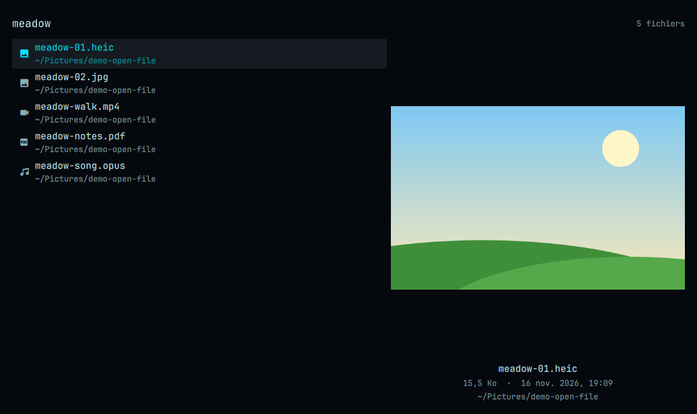

# Open a file — document-first launcher for Omarchy

A search panel for [Omarchy](https://omarchy.org) that starts from the document instead of
the application: type a few letters of a file name, see a preview, press Enter, and the
file opens in its default application.



## What it does

- Searches **every file in your home folder** by name, on each keystroke. The file list is
  read when the panel opens and filtered in memory, so there is no result limit and no
  index to maintain.
- Ranking: names that **start with** what you typed come first, then names that contain it,
  then files found through their folder name; most recent first inside each group.
- Case and accents are ignored (`evenement` finds `Événement.odt`). Several words narrow
  the search and may match the folder (`img downloads`).
- With an empty search it lists your most recently modified files.
- Preview pane:
  - images, **HEIC, AVIF and JPEG XL included**, as thumbnails;
  - the first page of PDFs;
  - videos play muted, in a loop;
  - audio files play (a pre-listen), with position and duration;
  - any file: name, size, date and folder.
- A video or an audio file only starts after the selection rests on it for 0.4 s, and
  stops as soon as you move on or close the panel.
- Follows the Omarchy theme (menu colours) and language (English and French shipped).

## Keys

| Key | Action |
|-----|--------|
| letters | filter |
| Up / Down, Page Up / Page Down | move in the list |
| Enter, or a click | open the file |
| Backspace, Ctrl+Backspace, Ctrl+U | edit the search |
| Escape | clear the search, then close |

## Requirements

- Omarchy with the Quickshell-based shell (Quattro).
- For previews, all optional — a missing tool only means a missing thumbnail:
  - `libvips` (`vipsthumbnail`) or `imagemagick` for images, plus `libheif` for HEIC/AVIF;
  - `poppler` (`pdftoppm`) for PDFs;
  - `ffmpegthumbnailer` for video thumbnails;
  - `qt6-multimedia` and `qt6-multimedia-ffmpeg` for video and audio playback in the panel.

## Install

```sh
omarchy plugin add https://github.com/swald54000/omarchy-open-file.git --enable
```

The plugin is an overlay, not a bar widget: give it a key. In
`~/.config/hypr/bindings.lua`:

```lua
o.bind("SUPER + ALT + SPACE", "Open file", "omarchy-shell shell toggle swald.files '{}'")
```

Use `o.rebind` instead of `o.bind` if the key is already taken.

## Settings

Hidden folders and folders named `node_modules`, `target`, `__pycache__`, `build`, `dist`
and `venv` are skipped. To skip more, list paths relative to your home folder, one per
line, in `~/.config/swald.files/exclude`:

```
# large trees with nothing to open
Games
Sources/linux
```

Thumbnails are cached in `~/.cache/swald.files` and dropped after 30 days.

## Remove

```sh
omarchy plugin remove swald.files
```

Then delete the key binding, and `~/.config/swald.files` and `~/.cache/swald.files` if
you created them.

## How it works

`OpenFile.qml` is the overlay. `Search.js` holds the filter and ranking (pure functions).
`open-file.sh` lists the files with `find`, builds thumbnails and opens the chosen file
with `xdg-open`; the panel calls it with argument arrays, never through a shell string.
`VideoPreview.qml` and `AudioPreview.qml` are loaded on demand. Nothing runs in the
background while the panel is closed, there is no network access, and no elevated
privileges are needed.

## Tests

```sh
node --test tests/
tests/test_script.sh
```

## License

[MIT](LICENSE)

---

[Version française](README.fr.md)
